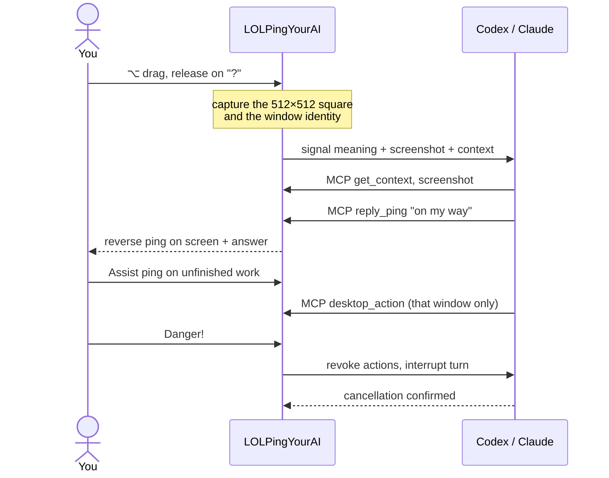

<div align="center">


# LOLPingYourAI

**Ping anywhere on your desktop. Your AI teammate gets the context.**

Hold <kbd>⌥ Option</kbd>, drag, release on a signal. A League-style ping sends the spot you pointed at, the window it belongs to and what the signal means to your Codex, Claude or DSH teammate. It pings back, explains, works in that window, and stops the moment you call **Danger**.

<a href="https://github.com/ChristianYang37/LOLPingYourAI/releases/latest"></a>
<a href="https://github.com/ChristianYang37/LOLPingYourAI/actions/workflows/ci.yml"></a>


<a href="LICENSE"></a>

**English** · [简体中文](README.zh-CN.md) · [Download](https://github.com/ChristianYang37/LOLPingYourAI/releases/latest) · [▶ Demo video](docs/media/promo-en.mp4) · [Architecture](docs/architecture.md) · [Verification](docs/verification.md)

<br>


<sub>🔊 Full demo with sound (47 s): <a href="docs/media/promo-en.mp4">English</a> · <a href="docs/media/promo-zh.mp4">中文</a></sub>

</div>

## Why

Writing *"in the PDF on the right, second equation, why divide by √d?"* takes longer than the question itself. In League you'd ping it. LOLPingYourAI brings that to your desktop. One gesture hands your AI teammate three things at once:

- **Where:** a 512×512 square around the pointer, mapped back to real screen coordinates.
- **What:** the window it belongs to (app, title, bounds, a stable window ID).
- **Intent:** the signal's instruction, such as *explain*, *help finish this*, *stop*, or *check back in 30 minutes*.

The teammate is your existing Codex, Claude or DSH harness, with its own model, account, tools and memory. LOLPingYourAI adds no planner and no separate history service. It supplies the ping, a bundled skill and a narrow set of desktop tools.

<table>
<tr>
<td width="33%" valign="top"><br><b>Point, don't describe</b><br>The screenshot, window and intent arrive as structured data, not as text typed into whichever terminal has focus.</td>
<td width="33%" valign="top"><br><b>Recovers what you meant</b><br>When a ping is ambiguous, the skill searches relevant sessions, project files and memory first. It asks you one focused question only if that isn't enough.</td>
<td width="33%" valign="top"><br><b>Interrupt any time</b><br>Danger and Retreat revoke desktop actions at once. "Stopped" means the harness actually confirmed the cancellation.</td>
</tr>
<tr>
<td valign="top"><br><b>It pings you back</b><br>Replies show up on screen as reverse pings: <i>on my way</i>, <i>all in</i>, <i>?</i>. They play one at a time, across displays, without moving your cursor.</td>
<td valign="top"><br><b>Wards that come back</b><br>Ward a window and the teammate looks again once, 30 minutes later. The visit survives restarts and sleep, and never runs twice.</td>
<td valign="top"><br><b>Your wheel, your emotes</b><br>Rebind slots and messages, import or crop emotes, or ask the teammate to draw one. Send a <i>Weak!</i> and it may talk back.</td>
</tr>
</table>

## Teammate experience

- The app opens to a dedicated chat home with full replies, a fixed composer and task status. Use the Settings button for configuration; switching back keeps your draft.
- You can also type directly on the chat home to start a conversation. Text-only chat needs no desktop capture permissions; ping a region when you want to share visual context.
- A small reply card appears near the target without requesting focus. Expand, copy, ask a follow-up or answer a clarification there.
- Agent pings and emotes stay visible for **6 seconds** by default. Adjust **Signals & Sound → AI reply duration** (3–15 seconds). Replies wait for both the preceding visual and sound to finish; sounds play once.
- Live status uses LoL icons: **received → understanding → working / waiting for you → done**. A completion reaction plays through the existing serial visual-and-sound queue.
- Normal pings queue behind active work; Danger/Retreat interrupt promptly; All In switches targets. Ward/clear-ward never cancel the active task, and reactions append to its conversation.
- First-run setup checks the harness and macOS permissions, then offers an observation-only test. Settings have **Teammate / Signals / Emotes / Wards** tabs and an English/Chinese switch. Wards show a countdown, cancel and visit-now controls.
- Selecting a harness loads its own model catalog. Model and fast-mode choices are saved per harness; fast mode is **off by default**, resets to off when changing models, and only appears enabled when the backend advertises support. Changes apply next turn.
- Reasoning defaults to **0**, the model's lowest supported level. **1** chooses the next level; larger indices clamp to the model's maximum. The effective level is displayed after a turn starts. DSH defaults to thinking on: its indices count enabled levels, with a separate off switch.
- **DeepSeek Harness (DSH)** is available through ACP. See [installation, free text API setup and verification limits](docs/dsh.md).

The chat-first interface is included in v0.1.2 for Windows. The older v0.1.1 macOS installer predates the chat-first integration.

## Signals

| | Signal | Your teammate… |
|:-:|---|---|
|  | **Question** | explains the square. Observe only. |
|  | **Assist** | inspects progress and helps finish. It recovers context first and asks if your intent is still unclear. |
|  | **Danger** | interrupts, looks at a fresh screenshot and your correction, then reassesses. |
|  | **On my way** | expands the target window and improves readability with reversible view changes. |
|  | **Ward** | comes back once in **30 minutes**, to observe and report only. |
|  | **All in** | shifts its work to this target. |
|  | **Weak!** | gets a playful complaint. A light comeback is allowed, and nothing is undone automatically. |
|  | **Retreat** | stops and hands control back. |
|   | **Nice / Celebrate** | keeps going, or celebrates a finished task. |
|  | **Clear ward** | cancels this window's pending visits. |

The original eight-slot layout is kept. Extra signals are in the slot picker: **Push**, **Attention here**, **Look here**. Every signal's message and behavior (observe, work, correct, stop, ward, emote) can be edited under **AI Teammate** in settings. The skill reads the current configuration on every ping.

## How it works



The native helper inherited from lolPing handles press, drag, release and cancel. A confirmed ping is captured and passed to a **persistent teammate session**. The same harness thread is resumed between pings and after app restarts, with no app-imposed idle expiry. Context management stays with the harness. Your messages, signals, agent replies and reverse pings are saved locally and shown in the chat window; use “Load earlier records” for older entries. The agent then works through a local MCP server: `get_context`, `screenshot`, `desktop_action`, `reply_ping`, `save_handoff` and `ward`. `submit_icon` is available only to a separate, explicitly requested icon-generation job. One action gate serializes desktop operations, and a correction invalidates every older one. Details are in [docs/architecture.md](docs/architecture.md).

## Quick start (macOS)

The macOS v0.1.1 installer predates the chat-first integration; build from current source for those changes on macOS.

1. **Install.** Download **LOLPingYourAI-0.1.1-arm64.dmg** from [Releases](https://github.com/ChristianYang37/LOLPingYourAI/releases/tag/v0.1.1) and drag the app to Applications. Quit the original lolPing first: only one global input helper should run at a time.
2. **Connect a teammate.** Install and sign in to [Codex CLI](https://developers.openai.com/codex/cli/) (`codex login`). The CLI bundled with the Codex desktop app is found automatically. Claude is experimental (see [Platform status](#platform-status)).
3. **Grant permissions.** Open the app, then enable **Accessibility** and **Screen Recording** for LOLPingYourAI in *System Settings → Privacy & Security* and restart it. **AI Teammate** in settings shows both checks.
4. **Ping.** Hover anything, hold <kbd>⌥ Option</kbd> + left mouse, drag, and release on **?**. <kbd>⌃ Control</kbd> + drag opens the emote wheel.
5. **Take control back** with **Retreat** or <kbd>⌃ Control</kbd> <kbd>⌥ Option</kbd> <kbd>Esc</kbd> (<kbd>Ctrl</kbd> <kbd>Alt</kbd> <kbd>Esc</kbd> on Windows).

Optional: paste a *goal / progress / next step* once under **AI Teammate → Task handoff**. Later pings continue from it.

<details>
<summary><b>Troubleshooting</b></summary>

- **"Apple could not verify…"**: this demo is ad-hoc signed and not notarized. Try to open it once, then choose **System Settings → Privacy & Security → Open Anyway**. If macOS says the app "is damaged", run `xattr -dr com.apple.quarantine /Applications/LOLPingYourAI.app`.
- **The app isn't in the permission list**: add it with **+**. After a rebuild or update, a stale permission may need removing (**–**) and adding again.
- **Codex not found**: quit the app and launch it with an explicit CLI path:
  ```sh
  LOLPINGAI_CODEX="$(command -v codex)" /Applications/LOLPingYourAI.app/Contents/MacOS/LOLPingYourAI
  ```
  `LOLPINGAI_CLAUDE` does the same for a specific Claude Code executable.
- **Approvals**: tool approvals, questions and permission requests from the harness appear under **AI Teammate**. Nothing is silently accepted.
- **Cost**: your model provider may charge for agent usage. The app supplies no account or API key.

</details>

## Quick start (Windows x64)

Download **LOLPingYourAI-Setup-0.1.2.exe** from [v0.1.2](https://github.com/ChristianYang37/LOLPingYourAI/releases/tag/v0.1.2). Install per user, connect a locally signed-in Codex CLI, and check the trigger key in Settings. Quit other lolPing/LOLPingYourAI instances first. The installer is unsigned.

The app discovers the Windows Codex desktop executable and standard npm installations. If needed, set `LOLPINGAI_CODEX` to the absolute `codex.exe` path before launching. Emergency stop is **Ctrl+Alt+Esc**. See [Windows build, tests and limitations](docs/windows.md).

## Platform status

| Combination | Status |
| --- | --- |
| macOS Apple Silicon + **Codex** | ✅ Real desktop loop tested with a live model (explain, edit, interrupt, restore, maximize, ward). DMG available. |
| macOS + **Claude** | 🧪 Experimental Agent SDK with read-only context tools. Protocol-tested; authenticated desktop verification is still pending. |
| macOS + **DSH** | 🧪 Real Bailian screenshot/edit/restore run on the preceding installed helper; current source has protocol and regression coverage. [Setup and limits](docs/dsh.md). |
| Windows x64 | Native window/input regressions and packaged app startup/restart tested on Windows 10; Windows 2022/2025 CI and NSIS lifecycle checks. Harness and hardware-specific limits are recorded in [Windows verification](docs/windows.md). |

What was actually exercised, and what wasn't, is recorded in [docs/verification.md](docs/verification.md).

## Safety and privacy

- **Local only.** The MCP server talks to the app over loopback with a random per-launch token. Browser-origin requests are refused. Captures, sessions, wards and tokens stay in `~/Library/Application Support/LOLPingYourAI` (`%APPDATA%/LOLPingYourAI` on Windows) and never belong in Git.
- **Scoped actions.** Question and ward visits cannot click or type. The window is re-resolved before every action, coordinates go stale when it moves, and a closed, locked or ambiguous target fails visibly.
- **Data to your provider.** The square and the instruction go to the harness and model you chose, under your existing account.
- **Claude's tools.** Only read-only `Read`, `Grep` and `Glob` plus the desktop tools are exposed. A pre-tool hook refuses credential folders, key files, whole-home sweeps and every other tool, even ones your global Claude settings allow.
- **Not a sandbox.** These controls protect the backend this project ships. Extra plugins you add to a harness are outside them.

## Configuration and CLI

Defaults: focus square **512×512** logical pixels, ward delay **0.5 h**. Change them in settings or from a terminal while the app runs:

```sh
node ai/cli.mjs help
node ai/cli.mjs doctor
node ai/cli.mjs status
node ai/cli.mjs ping '{"signal":"missing","point":{"x":640,"y":400}}'
node ai/cli.mjs config '{"regionSize":512,"wardHours":0.5}'
node ai/cli.mjs bind '{"harness":"codex","summary":"Goal, progress, next step"}'
node ai/cli.mjs stop
```

`lolpingai` is also the package bin. Where shell quoting differs, use `--file payload.json`. The CLI talks only to the running local app. `doctor` tells SDK availability apart from authenticated live operation. A per-signal example config is in [examples/config.json](examples/config.json).

## Emotes and art

Import PNG, JPEG, GIF or WebP under **Emotes**. **Create an emote** lets you crop to a square, keep transparency or remove a flat background, and preview before adding. You can also describe one, optionally with a reference image. The teammate uses an image tool if it has one, otherwise it draws an original SVG, and the preview labels which method it used. Imported emotes can carry their own instructions.

The bundled ping textures, sounds and 44 animated emotes are the League of Legends assets that upstream lolPing 0.5.1 ships. A local pack can override them, and **Restore LoL pack** removes the override.

## Develop

Requirements: Node 22+, pnpm 10 and Xcode command-line tools on macOS. On Windows: Visual Studio 2022 or later C++ build tools (C++20) and the .NET Framework C# compiler.

```sh
git clone https://github.com/ChristianYang37/LOLPingYourAI.git
cd LOLPingYourAI
pnpm install --frozen-lockfile --ignore-scripts
node node_modules/electron/install.js
pnpm build:helper && pnpm build:desktop
pnpm dev
```

<details>
<summary><b>Tests, packaging and project layout</b></summary>

```sh
pnpm typecheck
pnpm test:helper                                # C++ input helper
pnpm test                                       # Vitest + AI bridge tests
pnpm test:acceptance                            # Portable acceptance-tool protocol tests
pnpm test:performance                           # Local performance gates; no API calls
pnpm build && pnpm exec electron tools/check-assets.cjs
pnpm exec electron tools/check-agent-queue.cjs  # real overlay + Web Audio queue
pnpm exec electron tools/test-board.cjs         # disposable window for manual tests
pnpm dist:mac                                   # Apple Silicon DMG in release/
pnpm dist                                       # Windows x64 installer (run on Windows)
```

Reusable [acceptance tools](tools/acceptance/README.md) support Codex, Claude and DSH through the local bridge, with local-only diagnostic output. See the [Claude findings and repair plan](docs/claude-acceptance-audit.md) for the remaining native-input and UI issues.

| Path | What lives there |
| --- | --- |
| `native/hook-helper/` | C++ global input hook: press, drag, release, cancel (from lolPing) |
| `native/desktop/` | Swift / C# helpers: window lookup, capture, scoped input |
| `src/main/` | Electron main process, overlays, settings, teammate lifecycle |
| `src/renderer/` | Ping and emote wheel overlay, React settings window |
| `ai/` | Teammate service, Codex, Claude and DSH adapters, MCP server, local bridge, CLI |
| `skills/lolping-your-ai/` | The skill that teaches the agent what each ping means |
| `promo/` | Remotion source for the demo video and README media |

The production app ships without an asar archive so its standalone ESM MCP server and native `sharp` dependency resolve the same way inside Electron and in child Node mode. There is no upstream auto-update channel.

</details>

## Help wanted

- Run it on **Windows** and report what breaks.
- Repeat the **signed-in Claude** [acceptance script](docs/acceptance.md) with the integrated reply card and effort settings.
- Physical multi-monitor, mixed-DPI and sleep/lock testing.
- Developer ID signing and notarization for the macOS build.
- Integrating native Computer Use backends with the shared cancellation gate.

## Credits and license

Thanks to [@csxq0605](https://github.com/csxq0605) for the Claude acceptance investigation and reusable test scripts in [PR #8](https://github.com/ChristianYang37/LOLPingYourAI/pull/8). The findings informed the fixes in [PR #11](https://github.com/ChristianYang37/LOLPingYourAI/pull/11), and the adapted scripts now live in [`tools/acceptance/`](tools/acceptance/).

Thanks to [@fzh000543](https://github.com/fzh000543) for publishing an early [Windows portable build](https://github.com/fzh000543/LOLPingYourAI/releases/tag/v0.1.1-win.1) and contributing its packaging configuration and usage documentation in [PR #7](https://github.com/ChristianYang37/LOLPingYourAI/pull/7).

Derived from [darrenprx/lolPing](https://github.com/darrenprx/lolPing) 0.5.1, which provides the input helper, radial wheels, overlays, settings and emote import. Copyright © 2026 Danrui Meng, MIT. Code in this repository is MIT ([LICENSE](LICENSE)).

League of Legends artwork, animations and audio © Riot Games, Inc. They are **not** covered by the MIT license; see [THIRD_PARTY_NOTICES.md](THIRD_PARTY_NOTICES.md). This is an independent fan project, not endorsed by Riot Games, OpenAI or Anthropic.

Connection & diagnostics is off by default. Enable it explicitly in Settings → AI Teammate when troubleshooting. With it off, raw protocol events are not collected; chat and ping history remain available. See [performance testing](docs/performance.md) for CI scope, budgets and local measurements.
