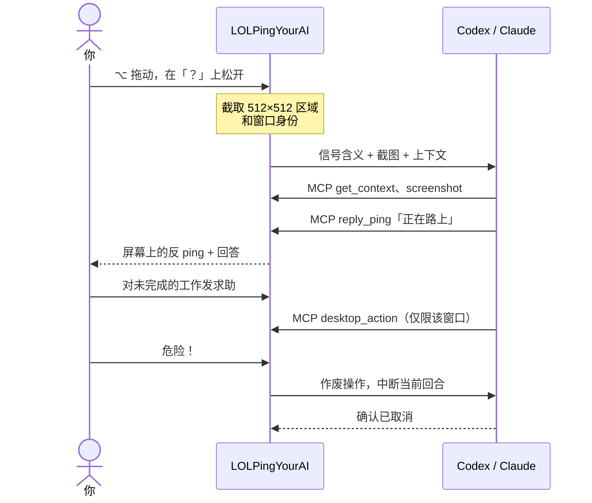

<div align="center">


# LOLPingYourAI

**在桌面任何地方 ping 一下，AI 队友立刻拿到上下文。**

按住 <kbd>⌥ Option</kbd> 拖动，松开选中信号。像在峡谷里打信号一样，把你指着的地方、它所在的窗口和这个信号的意思一起发给 Codex、Claude 或 DSH 队友。它会反 ping 你、解释、动手操作那个窗口；你喊一声 **危险**，它马上停下。

<a href="https://github.com/ChristianYang37/LOLPingYourAI/releases/latest"></a>
<a href="https://github.com/ChristianYang37/LOLPingYourAI/actions/workflows/ci.yml"></a>


<a href="LICENSE"></a>

[English](README.md) · **简体中文** · [下载](https://github.com/ChristianYang37/LOLPingYourAI/releases/latest) · [▶ 演示视频](docs/media/promo-zh.mp4) · [实现与接口](docs/architecture.md) · [实测记录](docs/verification.md)

<br>


<sub>🔊 带音效的完整演示（47 秒）：<a href="docs/media/promo-zh.mp4">中文</a> · <a href="docs/media/promo-en.mp4">English</a></sub>

</div>

## 为什么做这个

打字描述“右边 PDF 第二个公式，为什么要除以 √d？”，往往比问题本身还费劲。在峡谷里，你只会打一个信号。LOLPingYourAI 把这件事搬到桌面上，一个手势同时交给 AI 队友三样东西：

- **哪里**：鼠标周围 512×512 的正方形区域，并能换算回真实的屏幕坐标。
- **什么**：区域所在的窗口，包括应用、标题、位置和稳定的窗口 ID。
- **想干嘛**：信号对应的指令，例如*解释一下*、*帮我做完*、*停下*、*30 分钟后再来看看*。

队友就是你已经在用的 Codex、Claude 或 DSH harness，沿用它自己的模型、账号、工具和记忆。LOLPingYourAI 不另造规划器，也不另做历史检索服务，只负责 ping、内置的 skill 和一组范围很窄的桌面工具。

<table>
<tr>
<td width="33%" valign="top"><br><b>指一下，不用描述</b><br>截图、窗口和意图以结构化数据送达，不会被敲进恰好处于焦点的终端里。</td>
<td width="33%" valign="top"><br><b>先自己弄懂你的意思</b><br>信号含糊时，skill 会先检索相关会话、项目文件和记忆；仍不清楚才问你一个具体问题。</td>
<td width="33%" valign="top"><br><b>随时喊停</b><br>危险和撤退会立即作废桌面操作；只有 harness 真正确认取消后，界面才会显示“已停止”。</td>
</tr>
<tr>
<td valign="top"><br><b>会反 ping 你</b><br>回复以屏幕上的反向信号出现，比如<i>正在路上</i>、<i>交战</i>、<i>？</i>。多条回复跨屏幕依次播放，不会挪动你的鼠标。</td>
<td valign="top"><br><b>插眼会回来看</b><br>给窗口插个眼，队友 30 分钟后回来看一次。重启、睡眠后依然有效，也绝不会重复执行。</td>
<td valign="top"><br><b>轮盘和表情随你改</b><br>可以重排槽位、改信号内容，导入或裁切表情，也能让队友画一个。发个<i>弱爆</i>，它可能还会回嘴。</td>
</tr>
</table>

## 队友交互

- 应用默认打开聊天首页，展示完整回复、任务状态和固定输入框；右上角「设置」切换到分类配置，返回时保留输入草稿。
- 也可以在聊天首页直接打字开启会话，无需先 ping，也不依赖桌面录屏权限；需要画面上下文时再 ping 对应区域。
- 目标附近显示轻量回复卡，不主动抢焦点；可以展开、复制、追问和回答澄清。
- Agent 反 ping 和表情默认停留 **6 秒**，可在「信号与声音 → AI 反 ping 持续时间」调整为 3–15 秒。前一条图标、音效都结束后才显示下一条，音效只播放一次。
- 状态用 LoL 图标显示：**已收到 → 正在理解 → 正在执行／等你回答 → 已完成**。完成反应沿用图标与音效串行播放队列。
- 普通信号排队，警告／撤退立即中断，交战切换目标；插眼／排眼不打断当前任务，表情追加到原会话。
- 首次使用引导检查连接与权限，提供只读测试。设置分成**队友／信号／表情／回访**四页，并可切换中英文；回访支持倒计时、取消和立即回访。
- 选择 harness 后自动加载它的模型列表；每个 harness 分别保存模型与快速模式设置。快速模式**默认关闭**，换模型时重置为关闭，只有后端明确支持才允许开启；更改从下一轮生效。
- 思考强度默认 **0**，即当前模型最低档；**1** 是第二低档，超出范围取最高档。启动一轮后显示实际生效值。DSH 默认开启思考，数字只计算开启档，关闭思考使用独立开关。
- 新增 **DeepSeek Harness（DSH）ACP** 适配，详见[安装、免费 API 配置与验证范围](docs/dsh.md#中文)。

聊天首页已包含在 v0.1.2 Windows 版中；旧版 v0.1.1 macOS 安装包早于聊天首页的整合。

## 信号

| | 信号 | 队友会… |
|:-:|---|---|
|  | **问号** | 解释这个区域；只看不改。 |
|  | **求助** | 检查进度并帮你做完；先检索上下文，意图仍不明确时再问。 |
|  | **危险** | 立即中断，看最新截图和你的纠正，再重新判断。 |
|  | **正在路上** | 铺满目标窗口，用可恢复的方式改善阅读。 |
|  | **插眼** | **30 分钟后**回来看一次，只观察、只汇报。 |
|  | **交战** | 把工作重点转到这里。 |
|  | **弱爆** | 收到你的“吐槽”，可以轻松回敬一句；不会自动撤销任何工作。 |
|  | **撤退** | 停下并交还控制权。 |
|   | **点赞／喝彩** | 继续当前方向，或为完成的任务庆祝。 |
|  | **排眼** | 取消这个窗口待执行的回访。 |

保留原版八格轮盘布局；**推进**、**注意这里**、**看这里**等额外信号可在槽位选择器中找到。每个信号的内容和行为（观察、执行、纠错、停止、插眼、情绪）都能在设置的 **AI Teammate / 你的队友** 中修改，skill 每次 ping 都读取最新配置。

## 工作原理



沿用 lolPing 的原生输入助手，负责按下、拖动、松开和取消。确认后的 ping 会截图，并交给一个**持续存在的队友会话**：多次 ping 和应用重启后继续使用同一 harness 会话，不再按闲置时间刷新，上下文管理交给 harness。文字、信号、agent 回复与反 ping 在本地保存，并在聊天主窗口显示；点击「查看更早记录」可翻看历史。agent 通过本地 MCP 服务工作，可用工具有 `get_context`、`screenshot`、`desktop_action`、`reply_ping`、`save_handoff` 和 `ward`；`submit_icon` 只提供给用户显式发起的独立表情生成任务。所有桌面操作经同一个闸门串行执行，一次纠正会让此前的旧操作全部失效。详见 [docs/architecture.md](docs/architecture.md)。

## 快速开始（macOS）

已有 v0.1.1 macOS 安装包早于聊天首页整合；macOS 用户可从当前源码构建体验这些变化。

1. **安装**：在 [Releases](https://github.com/ChristianYang37/LOLPingYourAI/releases/tag/v0.1.1) 下载 **LOLPingYourAI-0.1.1-arm64.dmg**，把应用拖进「应用程序」。请先退出原版 lolPing，同一时间只应运行一个全局输入助手。
2. **连接队友**：安装 [Codex CLI](https://developers.openai.com/codex/cli/) 并执行 `codex login`；Codex 桌面应用自带的 CLI 会被自动找到。Claude 目前为实验性支持（见[平台状态](#平台状态)）。
3. **授权**：打开应用，在「系统设置 → 隐私与安全性」中为 LOLPingYourAI 开启**辅助功能**和**录屏与系统录音**，然后重启应用。设置里的 **AI Teammate / 你的队友** 会显示两项检查结果。
4. **开始 ping**：鼠标停在任意内容上，按住 <kbd>⌥ Option</kbd> + 左键拖动，在 **？** 上松开。<kbd>⌃ Control</kbd> + 拖动打开表情轮盘。
5. **收回控制**：选**撤退**，或按 <kbd>⌃ Control</kbd> <kbd>⌥ Option</kbd> <kbd>Esc</kbd>（Windows 为 <kbd>Ctrl</kbd> <kbd>Alt</kbd> <kbd>Esc</kbd>）。

可选：在 **AI Teammate → Task handoff / 绑定任务** 中一次性填写「目标／进度／下一步」，之后的 ping 都会接着它往下做。

<details>
<summary><b>常见问题</b></summary>

- **提示“无法验证开发者”**：这是临时签名、未公证的 demo。先尝试打开一次，再到「系统设置 → 隐私与安全性」点「仍要打开」。如果提示应用“已损坏”，执行 `xattr -dr com.apple.quarantine /Applications/LOLPingYourAI.app`。
- **权限列表里找不到应用**：点 **＋** 手动添加。重新打包或更新后，旧授权可能失效，需要先 **－** 移除再重新添加。
- **找不到 Codex**：退出应用，从终端指定 CLI 路径启动：
  ```sh
  LOLPINGAI_CODEX="$(command -v codex)" /Applications/LOLPingYourAI.app/Contents/MacOS/LOLPingYourAI
  ```
  `LOLPINGAI_CLAUDE` 可以用同样方式指定 Claude Code 可执行文件。
- **审批**：harness 的工具审批、提问和权限请求都会显示在 **AI Teammate** 中，不会被悄悄同意。
- **费用**：模型服务可能产生用量费用；本应用不提供账号或 API key。

</details>

## 快速开始（Windows x64）

在 [v0.1.2 发布页](https://github.com/ChristianYang37/LOLPingYourAI/releases/tag/v0.1.2) 下载 **LOLPingYourAI-Setup-0.1.2.exe**，按用户安装，连接本机已登录的 Codex CLI，并在设置页确认触发键。启动前退出其他 lolPing/LOLPingYourAI 实例。当前安装包未签名。

支持查找 Windows Codex 桌面应用内置程序和标准 npm 安装；必要时在启动前将 `LOLPINGAI_CODEX` 设为 `codex.exe` 的绝对路径。紧急停止键为 **Ctrl+Alt+Esc**。构建、测试和验证边界见 [Windows 说明](docs/windows.md)。

## 平台状态

| 组合 | 状态 |
| --- | --- |
| macOS Apple Silicon＋**Codex** | ✅ 已用真实模型跑通桌面闭环（解释、编辑、中断、恢复、最大化、插眼），提供 DMG |
| macOS＋**Claude** | 🧪 Agent SDK 适配器，带只读上下文工具；协议测试通过，尚待登录后的桌面实测 |
| macOS＋**DSH** | 🧪 前一安装版已完成百炼截图、编辑和恢复实测；当前源码已验证协议与回归。[安装与验证范围](docs/dsh.md#中文) |
| Windows x64 | 已在 Windows 10 验证原生窗口/输入回归及打包应用启动、重启；新增 Windows 2022/2025 CI 与 NSIS 安装生命周期检查。各 harness 和硬件验证边界见 [Windows 实测说明](docs/windows.md)。 |

哪些真正测过、哪些没有，都记录在 [docs/verification.md](docs/verification.md)。

## 安全与隐私

- **只在本机**：MCP 服务通过回环地址和每次启动随机生成的令牌与应用通信，拒绝来自浏览器页面的请求。截图、会话、插眼和令牌保存在 `~/Library/Application Support/LOLPingYourAI`（Windows 为 `%APPDATA%/LOLPingYourAI`），不会进入 Git。
- **操作有边界**：问号和插眼回访不能点击或输入；每次操作前重新确认窗口身份，窗口移动后旧坐标作废；目标关闭、锁屏或无法确定时明确报错。
- **数据只发给你选的服务**：截图区域和指令只会以你现有的账号发送给你选择的 harness 和模型。
- **Claude 的工具**：只开放只读的 `Read`、`Grep`、`Glob` 和桌面工具。工具调用前的钩子会拒绝凭据目录、密钥文件、对整个用户目录的检索以及其他所有工具，即使你的全局 Claude 设置允许它们。
- **不是沙箱**：这些限制保护的是本项目自带的后端；你另外给 harness 装的插件不在范围内。

## 配置与命令行

默认值：关注区域 **512×512** 逻辑像素，插眼 **0.5 小时**后回访。可以在设置中修改，也可以在应用运行时用终端修改：

```sh
node ai/cli.mjs help
node ai/cli.mjs doctor
node ai/cli.mjs status
node ai/cli.mjs ping '{"signal":"missing","point":{"x":640,"y":400}}'
node ai/cli.mjs config '{"regionSize":512,"wardHours":0.5}'
node ai/cli.mjs bind '{"harness":"codex","summary":"任务目标、进度、下一步"}'
node ai/cli.mjs stop
```

也可以通过包的 `lolpingai` bin 调用。shell 引号规则不同时，可用 `--file payload.json`。命令行只连接本机正在运行的应用；`doctor` 会区分“SDK 已安装”和“已登录可用”。按信号定制的中文配置示例见 [examples/config.json](examples/config.json)。

## 表情与素材

在「表情」中可以导入 PNG、JPEG、GIF、WebP。「创作表情」支持裁切成正方形、保留透明度或去掉纯色背景，添加前可预览。也可以描述想要的表情，并可附参考图：队友有图像工具就用图像工具，没有就画一个原创 SVG，预览会标明实际用了哪种方式。导入的表情可以绑定自己的指令。

内置的信号图标、音效和 44 个动态表情来自上游 lolPing 0.5.1 收录的英雄联盟素材。本地素材包可以覆盖它们，「恢复 LoL 素材」会清除覆盖。

## 开发

需要 Node 22+、pnpm 10；macOS 需要 Xcode 命令行工具，Windows 需要 Visual Studio 2022 或更新版本的 C++ 构建工具（C++20）和 .NET Framework C# 编译器。

```sh
git clone https://github.com/ChristianYang37/LOLPingYourAI.git
cd LOLPingYourAI
pnpm install --frozen-lockfile --ignore-scripts
node node_modules/electron/install.js
pnpm build:helper && pnpm build:desktop
pnpm dev
```

<details>
<summary><b>测试、打包与目录结构</b></summary>

```sh
pnpm typecheck
pnpm test:helper                                # C++ 输入助手
pnpm test                                       # Vitest + AI 桥接测试
pnpm test:acceptance                            # 跨平台验收工具的协议测试
pnpm test:performance                           # 无 API 的本地性能回归
pnpm build && pnpm exec electron tools/check-assets.cjs
pnpm exec electron tools/check-agent-queue.cjs  # 真实覆盖层 + Web Audio 播放队列
pnpm exec electron tools/test-board.cjs         # 手动测试用的一次性窗口
pnpm dist:mac                                   # 在 release/ 生成 Apple Silicon DMG
pnpm dist                                       # Windows x64 安装包（需在 Windows 上执行）
```

可复用的[验收工具](tools/acceptance/README.md)通过本地桥接支持 Codex、Claude、DSH，诊断输出仅保存在本地。尚未解决的原生输入和界面问题见 [Claude 问题审核与修复方案](docs/claude-acceptance-audit.md)。

| 路径 | 内容 |
| --- | --- |
| `native/hook-helper/` | C++ 全局输入钩子：按下、拖动、松开、取消（来自 lolPing） |
| `native/desktop/` | Swift／C# 助手：窗口定位、截图、受限输入 |
| `src/main/` | Electron 主进程、覆盖层、设置、队友生命周期 |
| `src/renderer/` | 信号与表情轮盘覆盖层、React 设置窗口 |
| `ai/` | 队友服务、Codex／Claude／DSH 适配器、MCP 服务、本地桥接、命令行 |
| `skills/lolping-your-ai/` | 教会 agent 理解每个信号的 skill |
| `promo/` | 演示视频与 README 动图的 Remotion 源码 |

正式包不使用 asar 归档，这样独立的 ESM MCP 服务和原生 `sharp` 依赖在 Electron 内和子 Node 进程中的解析方式完全一致。应用不接入上游的自动更新通道。

</details>

## 欢迎参与

- 在 **Windows** 上跑一跑，告诉我们哪里坏了。
- 用**已登录的 Claude** 重跑整合回复卡片和思考档位后的[验收步骤](docs/acceptance.md)。
- 物理多显示器、混合 DPI、睡眠／锁屏场景测试。
- macOS 版本的 Developer ID 签名与公证。
- 让原生 Computer Use 后端接入统一的取消闸门。

## 致谢与许可

感谢 [@fzh000543](https://github.com/fzh000543) 发布早期的 [Windows 便携版](https://github.com/fzh000543/LOLPingYourAI/releases/tag/v0.1.1-win.1)，并在 [PR #7](https://github.com/ChristianYang37/LOLPingYourAI/pull/7) 中提供便携版打包配置和使用文档。

基于 [darrenprx/lolPing](https://github.com/darrenprx/lolPing) 0.5.1 派生，输入助手、轮盘、覆盖层、设置和表情导入都来自它。Copyright © 2026 Danrui Meng，MIT。本仓库代码采用 MIT 许可（[LICENSE](LICENSE)）。

英雄联盟的美术、动画和音效 © Riot Games, Inc.，**不**适用 MIT 许可，详见 [THIRD_PARTY_NOTICES.md](THIRD_PARTY_NOTICES.md)。这是独立的粉丝项目，未获 Riot Games、OpenAI 或 Anthropic 认可。

连接与诊断默认关闭；需要排查时，在设置 → AI 队友中显式开启。关闭后不收集原始协议事件，聊天与信号记录正常保留。性能 CI 的范围、预算及本机测量见[性能测试说明](docs/performance.md)。
